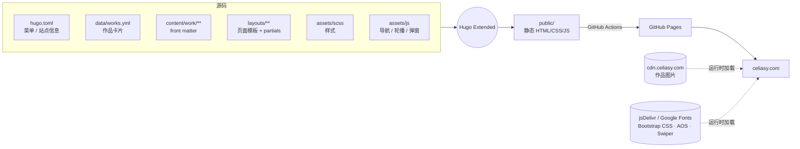
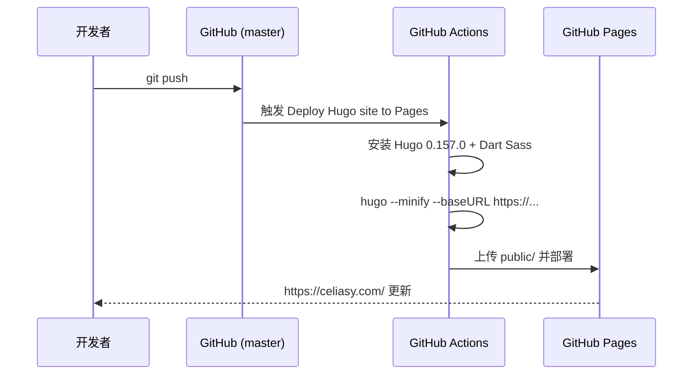

<div align="center">

<a href="https://celiasy.com/">
  
</a>

# Celia Shuyue Li · Portfolio

**AI 产品设计 · 多媒体艺术 · 空间设计**

把人、设计、艺术与技术编织在一起的个人作品集。

[](https://celiasy.com/)
[](https://github.com/artstur/celia-portfolio/actions/workflows/hugo.yml)
[](https://gohugo.io/)
[](https://sass-lang.com/)
[](assets/js/)
[](.github/workflows/hugo.yml)

[在线浏览](https://celiasy.com/) ·
[快速开始](#快速开始) ·
[新增作品](#三步新增一件作品) ·
[发布与验证](#发布流程)

</div>

---

## 这是什么

这是 [Celia Shuyue Li](https://celiasy.com/about/) 的个人作品集源码。它是一个**纯静态站点**：Hugo 模板负责组织页面，SCSS 负责视觉，几百行原生 JavaScript 负责导航、轮播与弹窗。没有 Node 构建链、没有后端、没有数据库，推送到 `master` 即自动发布到 GitHub Pages。

- **零依赖安装**：只需要一个 Hugo Extended，无需 `npm install`。
- **数据驱动的作品墙**：首页和分类页的卡片全部来自一份 [`data/works.yml`](data/works.yml)。
- **组件化的作品详情**：15 个可复用的 [`partials/work/`](layouts/partials/work/) 组件拼出每一个案例页。
- **可访问性优先**：skip link、可见焦点、`aria-expanded`、Escape 关闭、焦点陷阱、`prefers-reduced-motion` 全部内建。
- **按需加载**：Swiper 只在真正有轮播的作品页加载。

## 作品一览

站点按三个方向组织作品，分类页由 `type` 字段自动筛选。

<table>
  <tr>
    <th width="33%">Multimedia Art &amp; HCI</th>
    <th width="33%">Spatial Design</th>
    <th width="33%">UX &amp; Web3</th>
  </tr>
  <tr>
    <td valign="top">
      <a href="https://celiasy.com/work/multimedia-art-hci/knowing-river-through-sound/"></a><br>
      <sub>Knowing River Through Sound</sub><br><br>
      <a href="https://celiasy.com/work/multimedia-art-hci/a-collection-garments-of-discomfort/"></a><br>
      <sub>A Collection: Garments of Discomfort</sub><br><br>
      <a href="https://celiasy.com/work/multimedia-art-hci/stone-fized-history-and-tree-fized-temporary/"></a><br>
      <sub>Stone-fized History and Tree-fized Temporary</sub>
    </td>
    <td valign="top">
      <a href="https://celiasy.com/work/spatial-design/seeding-the-food-desert/"></a><br>
      <sub>Seeding the Food Desert</sub><br><br>
      <a href="https://celiasy.com/work/spatial-design/sandscape-sediment-mechanism/"></a><br>
      <sub>Sandscape: Sediment Mechanism</sub><br><br>
      <a href="https://celiasy.com/work/spatial-design/junctionscape/"></a><br>
      <sub>JunctionScape</sub>
    </td>
    <td valign="top">
      <a href="https://celiasy.com/work/ux-web3/armadillo/"></a><br>
      <sub>Armadillo</sub><br><br>
      <a href="https://celiasy.com/work/ux-web3/trust-finance/"></a><br>
      <sub>Trust Finance</sub><br><br>
      <a href="https://celiasy.com/work/ux-web3/payblocks-banking/"></a><br>
      <sub>PayBlocks Banking</sub><br><br>
      <a href="https://celiasy.com/work/ux-web3/buffet/"></a><br>
      <sub>Buffet</sub>
    </td>
  </tr>
</table>

## 快速开始

> **前置条件**：安装 [Hugo Extended](https://gohugo.io/installation/)。CI 固定为 **0.157.0**，需要复现 CI 结果时请使用相同版本。

```sh
git clone git@github.com:artstur/celia-portfolio.git
cd celia-portfolio

hugo version
hugo server --bind 127.0.0.1 --baseURL http://localhost:1313/
```

打开 <http://localhost:1313/>，修改模板、样式或数据后页面会自动刷新。

生产构建：

```sh
HUGO_ENVIRONMENT=production HUGO_ENV=production hugo --minify
```

产物写入 `public/`。`public/`、`resources/` 和 `.hugo_build.lock` 已被 Git 忽略，不作为源码提交。想保留现有本地产物时，可以把输出和缓存放到临时目录：

```sh
build_dir=$(mktemp -d /tmp/celia-build.XXXXXX)
hugo --minify --destination "$build_dir" --cacheDir "$build_dir/.cache"
```

<details>
<summary>关于 Sass</summary>

`layouts/partials/head.html` 通过 Hugo 的 `css.Sass` 编译 `assets/scss/style.scss`，没有显式指定 Dart Sass 转译器。CI 会另行安装 Dart Sass，但这不意味着本地必须先安装独立的 `sass` 命令。

</details>

## 它是怎么运转的



### 目录导览

```text
celia-portfolio/
├── hugo.toml                  # 域名、菜单、站点介绍、favicon、Google Analytics
├── data/works.yml             # 首页与 /work/ 的作品卡片、顺序、分类、链接
├── content/
│   ├── about/  contact/       # About 与 Contact 页的文案
│   └── work/<category>/       # 作品 front matter 与分类列表配置
├── layouts/
│   ├── _default/baseof.html   # 共享骨架：导航、主内容、页脚
│   ├── index.html             # 首页 = work-intro + work-list
│   ├── <category>/<slug>.html # 每个作品的详情正文
│   ├── partials/work/         # 可复用的作品组件
│   └── partials/auto-carousel-modal.html  # 自动图片轮播与共享图库弹窗
├── assets/
│   ├── scss/                  # 样式，入口 style.scss
│   └── js/
│       ├── script.js          # 导航展开、键盘操作、锚点滚动
│       └── init.js            # AOS、图片/视频轮播、视频播放与弹窗
├── static/                    # 原样复制的图片、字体、robots.txt
└── .github/workflows/hugo.yml # 构建并发布到 GitHub Pages
```

主导航只有 **About**、**Work**、**Contact**，Logo 返回首页。Work 下分 `multimedia-art-hci`、`spatial-design`、`ux-web3` 三类。站内只保留这三个作品分类和 About/Contact，首页就是作品总览。

### 模板路由一张表

| 内容文件 | 使用的模板 |
| --- | --- |
| `content/work/_index.md` | `layouts/work/list.html` |
| `content/work/<category>/_index.md` | `layouts/work/work-list-with-type.html` |
| `content/work/<category>/<slug>.md` | `layouts/<category>/<slug>.html` |

详情页用 `type` 选择模板目录，用 `layout` 写**不带目录**的模板名。例如 `type: 'multimedia-art-hci'` + `layout: 'knowing-river-through-sound'`。

## 三步新增一件作品

**1. 写 front matter**：新建 `content/work/<category>/<slug>.md`，参考同类现有作品。

```yaml
---
title: "Project | Celia Shuyue Li"
type: 'ux-web3'
layout: 'project'
work_header_title: "Project"
# has_carousel: true   # 仅当页面里有轮播时才加
---
```

**2. 写详情模板**：在 `layouts/ux-web3/project.html` 中定义 `main` 块，并拼装 `layouts/partials/work/` 里的组件。作品正文主要写在模板里；默认的 `layouts/_default/single.html` 主块为空，单独写 Markdown 正文**不会**自动成为作品详情。

**3. 登记卡片**：在 `data/works.yml` 的 `work_item` 中追加一项。

```yaml
  - title: "Project"
    img: "https://cdn.celiasy.com/images/index/compressed/<n>.jpg"
    url: "/work/ux-web3/project/"
    type: "ux-web3"
```

分类列表按卡片的 `type` 与分类 `_index.md` 中的 `data_type` 精确匹配；只新增内容文件不会自动出现卡片。

> [!TIP]
> - URL 一律写成带尾斜杠的 `/work/<category>/<slug>/`，与 Hugo 生成的 permalink 保持一致。
> - `work_header_title` 只用于渲染作品页头部；Swiper 的 CSS/JS 由 `has_carousel: true` 单独控制。没有轮播的页面不要加，避免白白加载一份 Swiper。
> - 需要图片或视频弹窗时，按需引入对应 partial。
> - 页面个性化（卡片底色、文字色等）优先通过 partial 参数传入。动态拼接 `style` 时使用 `printf "style=%q" $style | safeHTMLAttr`，避免 Hugo 输出 `ZgotmplZ`。

### 图片与媒体

主要作品图片托管在 `https://cdn.celiasy.com/images/`，视频使用外部嵌入；**Hugo 构建不会验证这些远端资源**。上传前可用 [iLoveIMG](https://www.iloveimg.com/zh-cn/compress-image/compress-jpg) 压缩 JPG，并为图片保留真实宽高和恰当的 `alt`。

> [!WARNING]
> `format_file.py` 会直接把指定目录内的文件名改为小写并用连字符替换空格。使用前请确认 CDN 上的资源 URL 和模板中的引用会同步更新。

## 交互细节

| 能力 | 行为 |
| --- | --- |
| 导航 | 折叠断点与 Bootstrap `navbar-expand-lg` 一致（`max-width: 991.98px`）；窄屏点击 Work 展开分类，桌面支持 hover 与键盘焦点 |
| 键盘 | skip link、可见焦点、`aria-expanded` 同步、Escape 关闭菜单和弹窗 |
| 图片轮播 | 每 4 秒自动切换；悬停或聚焦时暂停；`prefers-reduced-motion` 下关闭自动播放 |
| 弹窗 | 焦点进入并被限制在弹窗内，关闭后焦点返回、背景滚动恢复、iframe 停播 |
| 手机视频 | 宽度 `<= 575px` 时点击封面内联播放；All Videos 仍打开弹窗 |

导航交互由 `assets/js/script.js` 实现，Bootstrap 只提供 CSS，不再引入 jQuery 或 Bootstrap JS。

## 运行时依赖

| 依赖 | 来源 | 用途 |
| --- | --- | --- |
| Bootstrap 4.6.2（仅 CSS） | jsDelivr | 栅格与基础样式 |
| Font Awesome | jsDelivr | 页脚社交图标 |
| AOS | jsDelivr | 滚动入场动画 |
| Swiper 11.2.6 | jsDelivr | 作品页轮播（按需加载） |
| Google Fonts | Google | 网页字体 |

页面视觉和交互依赖这些服务可访问。`layouts/partials/footer.html` 依次加载 `script.js`、AOS、按需的 Swiper 和 `init.js`；旧的 `vendor.js`、`formhandler.js` 标签保持注释状态。Contact 页只展示联系方式，没有启用表单后端。

## 发布流程



[`.github/workflows/hugo.yml`](.github/workflows/hugo.yml) 在推送到 `master` 或手动触发时运行。构建时用 Pages 输出的 `base_url` 覆盖 `hugo.toml` 中的 `baseURL`，并统一升级为 `https://`，确保 canonical、`og:url` 与 sitemap 不落到 http。域名、DNS 与 Pages 设置在托管端管理。

## 验证

仓库没有自动化测试套件，每次修改后按下面的清单自查。

1. **生产构建**通过：`HUGO_ENVIRONMENT=production HUGO_ENV=production hugo --minify`
2. **安全过滤检查**无匹配（`rg` 返回 1 即为正常）：

   ```sh
   rg -n 'ZgotmplZ' public -g '*.html'
   ```

3. **浏览器走查**：首页、三个分类页、修改过的作品页、About、Contact。
   - [ ] 桌面与窄屏导航
   - [ ] 键盘 Tab / Escape
   - [ ] 轮播悬停暂停
   - [ ] 图片/视频弹窗关闭后的焦点与滚动恢复
   - [ ] CDN 图片与视频正常加载

构建通过只证明静态生成成功，不等于线上发布或交互验收。

> [!NOTE]
> 2026-10-22 曾用本地 Hugo Extended 0.162.1 构建成功，但该版本对 `languageCode`、`.Site.LanguageCode`、`.Site.Data` 报弃用警告。升级 CI 前需要先处理并验证兼容性；CI 版本以 workflow 为准。

## 参与维护

- 动手前先读本文件和 [`AGENTS.md`](AGENTS.md)，以当前模板、配置和命令输出为准。
- 修改作品时同时检查 front matter、详情模板和 `data/works.yml` 卡片三处。
- 复用 `layouts/partials/work/` 组件，不要退回到页面内硬编码的重复块；所有页面共用 `layouts/_default/baseof.html`。
- 不提交 `public/`、`resources/`、锁文件或本机配置。
- 提交信息沿用 [Conventional Commits](https://www.conventionalcommits.org/) 风格，例如 `fix(nav): ...`、`feat(works): ...`。

## 版权

站点中的作品、图片、视频与文案版权归 Celia Shuyue Li 所有，© ArtStur Associates. All Rights Reserved. 未经授权请勿转载或复用。

<div align="center">
<sub>Built with <a href="https://gohugo.io/">Hugo</a> · Designed by Celia Shuyue Li · <a href="https://celiasy.com/contact/">Let's Collaborate</a></sub>
</div>
